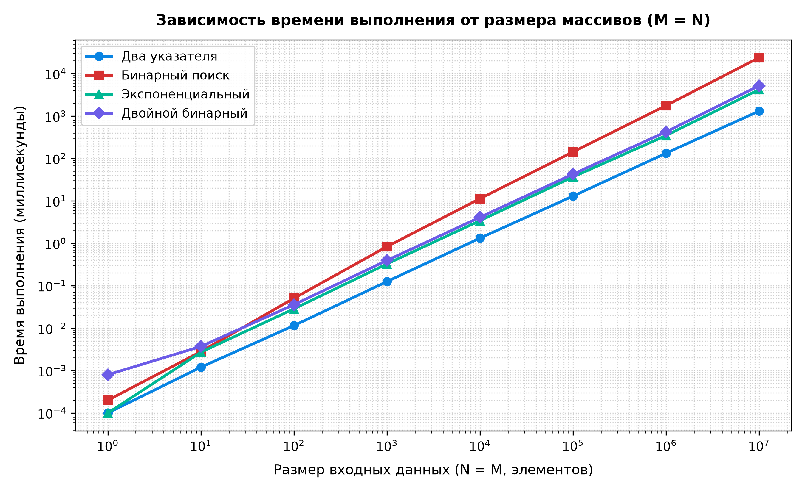
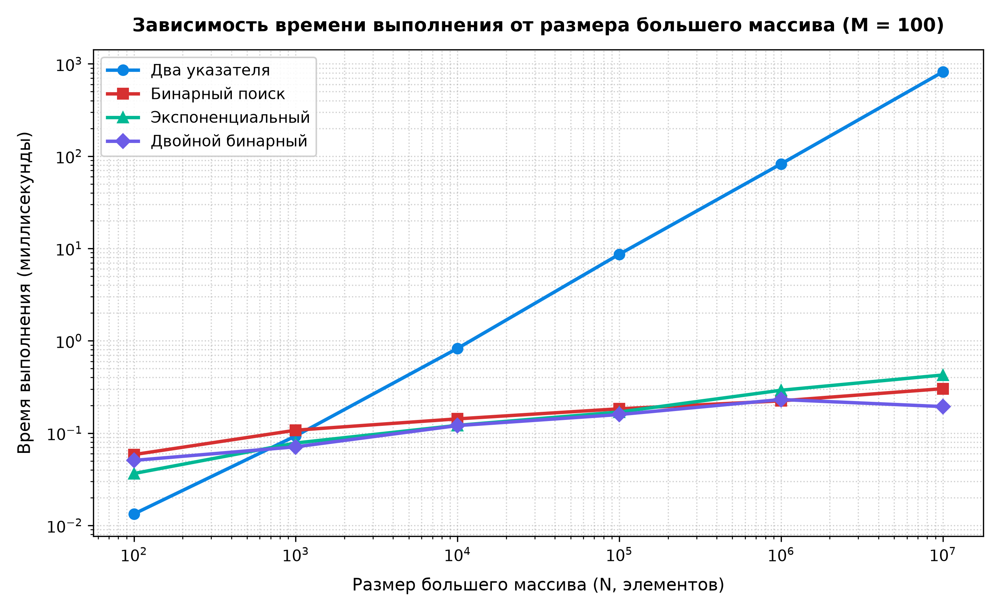

# Лабораторная работа 1: поиск общего элемента в двух массивах

Даны два отсортированных массива целых чисел. Нужно вернуть True, если у них есть хотя бы одно общее число, и False, если пересечений нет.
Цель: написать 4 разных алгоритма и сравнить их скорость на разных размерах данных.

Запуск тестов и отрисовка графиков в файле `main.py`.

---

## Реализованные алгоритмы

* **Два указателя (`two_points.py`)**: ставим по указателю на начало каждого массива. Смотрим, где число меньше — тот указатель и сдвигаем вправо. Если числа совпали, возвращаем True. Время O(M + N), по памяти O(1).
* **Бинарный поиск (`binary_search.py`)**: берем меньший массив и каждый его элемент ищем обычным бинарным поиском во втором массиве. Время O(M * log N), память O(1).
* **Экспоненциальный поиск (`exponential_search.py`)**: берем элемент из меньшего массива, а во втором массиве шагаем вперед с ускорением (шаг 1, 2, 4, 8...), пока не перепрыгнем нужное число, а потом доискиваем бинпоиском. Время O(M * log(2N/M)), память O(1).
* **Двойной бинарный поиск (`double_binary.py`)**: делим массив пополам, берем число из середины и бинпоиском находим его место во втором массиве. Дальше рекурсивно запускаемся для левой и правой половины. Время O(M * log(2N/M)), по памяти O(log M) из-за рекурсии.

---

## Как тестировалось

* Чтобы алгоритмы не выходили раньше времени и считали в самом худшем случае, массивы генерировались без общих чисел: в один записывались только четные числа, а во второй только нечетные.
* В тесте, где один массив маленький (100 элементов), а второй большой (до 10 миллионов), числа маленького массива равномерно раскиданы по всему диапазону большого, чтобы двум указателям пришлось пройти весь массив до конца.
* Время замерялось через `time.perf_counter()` с усреднением по повторам.

---

## Результаты

### 1. Массивы одинаковой длины (от 100 до 10 000 000 элементов)

Когда массивы одинакового размера, быстрее всего работают два указателя. Код делает всего одно сравнение и сдвигает индекс, ничего лишнего не вычисляется.
Обычный бинпоиск тут самый медленный, потому что на 10 миллионах он тратит аж 23 секунды (в 18 раз медленнее двух указателей).

---

### 2. Один массив маленький (100 элементов), второй огромный (до 10 000 000)

Тут ситуация меняется на противоположную. Два указателя начинают сильно тормозить (почти секунда на 10 миллионах), потому что им приходится по очереди просматривать абсолютно все элементы огромного массива.
А бинпоиск, экспоненциальный и двойной бинарный отрабатывают мгновенно (меньше 1 миллисекунды), потому что сразу отсекают огромные куски и не идут подряд по всем элементам.

---

## Выводы

1. Если массивы примерно одинаковые по размеру — лучше всего использовать два указателя. Это самый простой алгоритм, и он работает быстрее всех, потому что проходит массивы линейно за один проход без лишних вычислений.
2. Если один массив короткий, а второй длинный — два указателя использовать нельзя, они будут медленно перебирать весь длинный массив. В этом случае лучше брать бинпоиск, экспоненциальный или двойной бинарный — они работают в тысячи раз быстрее.
3. Между экспоненциальным и двойным бинарным по скорости разницы почти нет. Но экспоненциальный проще и работает в обычном цикле, а двойной бинарный использует рекурсию и забивает стек вызовов.
